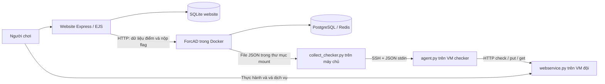

# Luồng hoạt động, quan hệ giữa các file và khả năng tái sử dụng

Ngày đối chiếu mã nguồn: 02/11/2026. Workspace: `C:\Users\Admin\Desktop\MekoData_Ky\atk_def_platform`.

Các đường dẫn rút gọn trong cây và bảng dưới đây tính từ workspace này. Đây là phân tích tĩnh mã nguồn và cấu hình hiện có; không khẳng định trạng thái container, tiến trình website hoặc máy ảo đang chạy. Không triển khai hay reset môi trường trong lần phân tích này.

## 1. Hệ thống làm gì?

Đây là workspace tổ chức cuộc thi Attack/Defense CTF: đội đăng ký trên website, nhận môi trường thực hành, bảo vệ dịch vụ của mình, lấy flag từ đội khác và nộp flag để tính điểm.

Có ba khối chạy riêng:

1. **MekoDataCTF Website**: quản lý tài khoản, đội, thành viên, thông tin giải; cung cấp World Arena và form nộp flag.
2. **ForcAD**: quản lý đội/task của engine, điều phối tick, sinh và kiểm tra flag, nhận flag, tính điểm, điều khiển cuộc thi.
3. **CyberRange và lab**: tạo VM/mạng, cài ứng dụng, chạy dịch vụ có lỗ hổng và checker trên mạng lab.

Website dùng SQLite của riêng mình. ForcAD dùng PostgreSQL và Redis. Ứng dụng lab và checker có SQLite riêng. Những cơ sở dữ liệu này không tự động là một và không chia sẻ cùng bảng `teams`.



Mũi tên không có nghĩa mọi file đều `import` nhau. Hệ thống kết nối bằng cả import, HTTP API, tiến trình con, SSH, file JSON và cấu hình systemd.

## 2. Vai trò các thư mục

| Thư mục/file | Vai trò và thứ đọc/sử dụng nó |
|---|---|
| `platform/` | Hai ứng dụng nền tảng, dùng qua nhiều cuộc thi/lab. |
| `platform/MekoDataCTF_Website/` | Ứng dụng Node.js/Express; điểm vào `app.js`. |
| `platform/ForcAD-demo/` | Engine ForcAD, giao diện quản trị, cấu hình Docker và checker adapter. |
| `labs/` | Nội dung riêng từng lab. Hiện có lab triển khai `round1`; `_template` là mẫu. |
| `labs/round1/lab.json` | Cấu hình đội, IP, alias SSH, checker host, task cho loader/script. Chưa điều khiển toàn bộ backend và topology. |
| `labs/round1/sandbox/` | Bộ Sandbox Definition cho CyberRange, có topology, provisioning, ứng dụng nền và checker HTTP. |
| `labs/round1/service/` | Dịch vụ thi IDOR/SQLi/Upload; agent checker; công cụ deploy/recycle; test. |
| `shared/labconfig.py` | Hàm dùng chung đọc cấu hình lab và tạo argv SSH. |
| `shared/service-checker/` | Checker có thể chạy độc lập: kiểm tra HTTP và luồng ServiceDesk. Không phải toàn bộ hệ thống chấm flag. |
| `ops/pool101/` | Cấu hình kết nối SSH và known-hosts phục vụ vận hành. Được `labconfig.ssh()` đưa vào lệnh SSH; không phải ứng dụng web. |
| `tools/modeling/` | Script tạo/sửa mô hình StarUML. |
| `tools/understand-anything/` | Mã công cụ phân tích/dashboard bên thứ ba cài trong workspace; không phải module xử lý thi. Có dependency/build riêng. |
| `tools/scenarios/` | Dữ liệu/kịch bản dùng tạo mô hình sequence và minh họa luật điểm. Không phải engine tính điểm thực tế. |
| `tools/rendering/` | Xuất ảnh mô hình qua StarUML API cục bộ. |
| `tools/documents/` | Tạo/chỉnh tài liệu Word từ tài nguyên tham chiếu. |
| `models/mekodatactf/` | File `.mdj` mở bằng StarUML; là mô hình thiết kế, không chạy cùng server. |
| `docs/` | Hướng dẫn, giải thích, quyết định và tài liệu vận hành. |
| `assets/references/` | Tài nguyên đầu vào cho công cụ tài liệu. Tài nguyên website nằm riêng dưới `public/`. |
| `artifacts/` | Đầu ra/bản lưu: báo cáo, PDF và gói phát hành `.tar`. Không phải nguồn đang chạy của lab. |
| `.ua/`, `platform/MekoDataCTF_Website/.ua/` | Bản đồ phân tích Understand-Anything. Có dữ liệu trước khi đổi cấu trúc; không dùng làm bằng chứng duy nhất về đường dẫn hiện tại. |
| `.claude/` | Cấu hình hỗ trợ khởi chạy/phát triển, không thuộc luồng thi. |
| `.git/` | Lịch sử và metadata Git. |
| `.gitignore`, `.understandignore` | Quy tắc bỏ qua của Git và công cụ phân tích. |
| `adjust_settings.md` | Bảng chỉ dẫn thay thông số ở đâu. |
| `README.md` | Điểm đọc đầu tiên và bản đồ workspace. |

Các thư mục sinh ra khi cài/chạy cũng có vai trò riêng: website `node_modules/` chứa thư viện, `data/` chứa SQLite; ForcAD `front/dist/` chứa frontend đã build, `docker_volumes/` chứa dữ liệu PostgreSQL, `checkers/*/rpc/` và `mekodata_bridge/responses/` chứa dữ liệu trao đổi. File `.dump` là bản sao lưu DB; log là lịch sử chạy; `.secrets/` là trạng thái bí mật phục vụ triển khai. Chúng không nên được sao chép như mã nguồn mẫu của cuộc thi mới.

## 3. Website: từ URL đến dữ liệu và giao diện

### 3.1 Điểm khởi chạy và các lớp

```text
package.json: npm start
  -> node app.js
     -> config/database.js -> schema.sql -> SQLite
     -> middlewares/i18n.js, locals.js, csrf.js
     -> routes/*
     -> services/forcadSync.js: start()
```

`app.js` lắp Express, EJS, thư mục file tĩnh, session lưu SQLite, parser, middleware và route. `config/database.js` mở DB, tạo schema và bổ sung một số cột của DB cũ.

| Thư mục website | Chức năng |
|---|---|
| `routes/` | Ghép URL với hàm xử lý. Riêng `scoreboard.js` cũng chứa logic chuyển tiếp API. |
| `controllers/` | Kiểm tra dữ liệu form, áp dụng quy tắc nghiệp vụ và quyết định render/redirect. |
| `models/` | Truy vấn và cập nhật SQLite. |
| `services/` | Tích hợp ForcAD, dựng trạng thái Arena và xuất danh sách đội. |
| `middlewares/` | Xác thực/quyền, CSRF, ngôn ngữ, dữ liệu dùng chung trong view. |
| `views/` | Template HTML EJS; `layouts/` là khung trang, `partials/` là phần giao diện dùng lại. |
| `public/js/`, `public/css/`, `public/images/` | Mã và tài nguyên gửi cho trình duyệt. |
| `config/` | DB/schema, nội dung mặc định, bản đồ Arena, cấu hình con giáp. |
| `locales/` | Chuỗi giao diện tiếng Việt và tiếng Anh. |
| `helpers/format.js` | Định dạng nội dung/ngày giờ trong view. |
| `scripts/` | Công cụ chạy riêng: seed, sinh ảnh bản đồ, đồng bộ token, xuất đội sang lab. |

### 3.2 File nào gọi file nào?

| Điểm vào | Chuỗi gọi chính | Mục đích |
|---|---|---|
| `GET /` | `app.js -> routes/index.js -> homeController.index -> Content, Setting, Team -> views/home.ejs` | Hiện giới thiệu, lịch và thông tin giải. |
| `POST /register` | `routes/auth.js -> authController.register -> Setting, User -> config/database.js` | Kiểm tra thời gian mở đăng ký và tạo tài khoản đội trưởng, tạo phiên, chuyển sang form đội. |
| `POST /login` | `routes/auth.js -> authController.login -> User` | Đăng nhập bằng email/mật khẩu. |
| `POST /login/token` | `routes/auth.js -> authController.tokenLogin -> Team.findByToken` | Thành viên vào bằng token đội. |
| `POST /team` | `routes/team.js -> requireCaptain -> teamController.save -> Team.createWithMembers/updateWithMembers -> Member` | Lưu đội và thành viên trong transaction; yêu cầu đồng bộ token qua `forcadSync.requestSync`. |
| `/admin/*` | `routes/admin.js -> requireAdmin -> adminController -> Team/Member/User/Setting/Content` | Quản trị thông tin giải và đội. |
| `/admin/export.xlsx`, `/admin/export.csv` | `adminController -> services/exportService.js -> Team` | Xuất hồ sơ đăng ký. |
| `GET /scoreboard` | `routes/scoreboard.js -> sessionTeam, Team, config/arenaMap.js -> views/scoreboard.ejs` | Dựng trang World Arena và thông tin đội đang đăng nhập. |
| `/scoreboard/stream`, `/scoreboard/state` | `routes/scoreboard.js -> arenaService.subscribe/sendState -> ForcAD client API` | Truyền trạng thái thi ra trình duyệt. |
| `POST /scoreboard/submit` | `routes/scoreboard.js -> sessionTeam -> HTTP PUT ForcAD /flags/` | Nộp flag với token của đội trong phiên. |

Các model `User.js`, `Team.js`, `Member.js`, `Setting.js`, `Content.js` đều dùng `config/database.js`. `Team.js` còn dùng `Member.js` để đọc/thay danh sách thành viên.

**Đăng ký tài khoản và tạo đội là hai bước:** `authController.register` tạo user; sau đó `teamController.save` mới tạo đội và token. Mã đăng ký được đọc không có bước gửi email; email xác nhận trong mô hình/tài liệu chưa chứng minh có chức năng gửi email ở runtime.

### 3.3 Đồng bộ tên đội và token

```text
models/Team.js
  -> slugOf / forcadNameOf / forcadCandidates
  -> services/forcadSync.js: syncTokens()
     -> POST /api/admin/login/
     -> GET /api/admin/teams/
     -> PUT /api/admin/teams/<id>/  (cập nhật token nếu cần)
```

Chiều đồng bộ là **website -> ForcAD**. Hàm ghép đội theo tên ForcAD khai riêng; nếu không khai thì thử slug và tên gốc. Hàm không tự tạo đội thiếu trên ForcAD. Đồng bộ chạy khi website khởi động, định kỳ mặc định 60 giây, sau các thay đổi liên quan đội/token/tên ForcAD. CLI `scripts/sync-forcad-tokens.js` gọi lại cùng service.

`scripts/export-lab-teams.js -> Team.listAll/forcadNameOf -> labs/<lab>/lab.json` là nhánh xuất cấu hình khác: mặc định chỉ in JSON; tùy chọn `--write` ghi danh sách đội vào lab đã có. Nó không tự tạo VM, sửa topology hay tạo đội trên ForcAD.

**Có hai loại token khác nhau:** token đội trên website/ForcAD dùng đăng nhập/nộp flag; token admin nội bộ do `deploy.py` tạo dùng cho agent đặt flag lên dịch vụ. Không dùng chúng thay cho nhau.

### 3.4 Điểm được hiển thị như thế nào?

```text
ForcAD /api/client/tick-status/, /teams/, /arena/
  -> services/arenaService.js
     -> cache + gộp request + lọc trường công khai
     -> SSE /scoreboard/stream (hoặc JSON /scoreboard/state + ETag)
  -> public/js/arena.js
     -> cập nhật bảng điểm; phát sự kiện arena-state
  -> public/js/world.js
     -> vẽ/điều khiển hiệu ứng bản đồ; xử lý form nộp flag
```

Website hiển thị điểm lấy từ ForcAD. `world.js` không phải nơi quyết định điểm hợp lệ. SSE là kết nối đẩy trạng thái từ website tới trình duyệt; phía website vẫn hỏi ForcAD theo chu kỳ khi có người xem.

## 4. ForcAD: khởi động, chấm bài và nhận flag

### 4.1 Khởi động

`docker-compose.yml` định nghĩa initializer, ticker, Celery, Flower, client API, admin API, events, HTTP receiver, Nginx, PostgreSQL, Redis và RabbitMQ.

```text
docker-compose.yml
  -> docker_config/initializer/entrypoint.sh
     -> backend/scripts/full_reset.py -> reset_db.py + init_db.py (khi chưa khởi tạo)
  -> docker_config/services/entrypoint.sh -> functions.sh -> start_<SERVICE>
       -> ticker: backend/services/ticker/__main__.py
       -> api/admin/events/http_receiver: thư mục tương ứng, gunicorn app:app
  -> docker_config/celery/entrypoint.sh -> services/tasks/app.py (worker hoặc Flower)
  -> nginx: docker_config/nginx/http.conf.template + front/dist/
```

`control.py -> cli/__init__.py -> cli/base/*` là bộ lệnh quản lý ForcAD. `cli/base/setup.py` sinh cấu hình và Compose theo tùy chọn; các lệnh start/build/pause/resume/reset dùng helper chạy Docker và backend script. Không có một `app.py` duy nhất chạy toàn bộ ForcAD.

| Thành phần | Chức năng |
|---|---|
| `backend/services/ticker/` | Đồng hồ/điều phối lượt chạy. |
| `backend/services/tasks/` | Tác vụ Celery kiểm tra dịch vụ theo đường engine gốc. |
| `backend/services/api/` | API dữ liệu công khai. |
| `backend/services/admin/` | Đăng nhập quản trị, đội, task, log, điều khiển round. |
| `backend/services/http_receiver/` | Nhận danh sách flag và trả kết quả. |
| `backend/services/events/` | Socket.IO phục vụ frontend ForcAD. |
| `backend/lib/models/` | Kiểu dữ liệu: Team, Task, Flag, Verdict, GameState... |
| `backend/lib/storage/` | Đọc/ghi dữ liệu, cache và nghiệp vụ liên quan trạng thái/điểm. |
| `backend/lib/flags/` | Judge, theo dõi submit, phát thông báo flag. |
| `backend/lib/helpers/` | Chạy checker, subprocess, sự kiện, job và lỗi dùng chung. |
| `backend/lib/config/` | Đọc/diễn giải cấu hình. |
| `backend/scripts/` | SQL schema/functions, khởi tạo/reset và thao tác vận hành. |
| `checkers/round1/` | Adapter giao thức checker cho health, IDOR, SQLi, Upload. |
| `docker_config/` | Dockerfile, entrypoint, Nginx và cấu hình kết nối dịch vụ. |
| `scripts/`, `.github/` | Script build/release/test và workflow hỗ trợ phát triển. |
| `tests/` | Test engine cùng dịch vụ/checker mẫu dùng thử. |
| `static/` | Tài nguyên minh họa của dự án; frontend chạy lấy từ `front/dist/`. |

PostgreSQL lưu kết quả chính. Redis lưu cache/trạng thái tra cứu nhanh. RabbitMQ là broker cho Celery và hạ tầng truyền sự kiện; Flower theo dõi worker.

### 4.2 Hai nhánh điều phối cần phân biệt

`backend/services/ticker/__main__.py:main()` chọn nhánh dựa trên `round1.configured()`.

**Nhánh engine gốc/classic và bản demo health:**

```text
ticker/__main__.py
  -> ticker/hooks/classic_round.py: run_classic_round()
     -> utils.py: tạo task signature / cập nhật round
     -> Celery -> services/tasks/actions.py: check_action / put_action / get_action
        -> lib/helpers/checkers.py: CheckerRunner
        -> lib/helpers/commands.py -> chạy checker bằng subprocess
     -> services/tasks/handlers.py -> storage.tasks.update_task_status
```

Nhánh classic hiện còn gửi yêu cầu `mekodata_bridge/request.json` để collector lấy kết quả health mới từ VM. `checkers/mekodata_bridge/bridge.py` đọc response đúng request/tick, trả mã checker; file này có trong workspace nhưng đang bị Git ignore. Vì vậy một checkout mới có thể chưa đủ phần cầu nối health. `configure_mekodata_demo.py` đăng ký bốn đội và task health-only trỏ tới bridge đó.

**Nhánh Round 1 tùy biến:**

```text
ticker/__main__.py
  -> lib/storage/competition.py: pump()
     -> schedule_puts() -> put_flag() -> CheckerRunner.put()
     -> hết thời gian tick: verify() -> CheckerRunner.check()/get()
     -> ghi trạng thái TeamTasks và MekodataSLA
     -> storage.game.update_game_state()
```

Round 1 dùng `ThreadPoolExecutor` trong tiến trình ticker cho PUT/verify. Không nên mô tả rằng tất cả checker Round 1 đều bắt buộc đi qua Celery.

### 4.3 Một lần gọi checker Round 1 đi hết hệ thống

```text
competition.py -> CheckerRunner -> helpers/commands.py
  -> checkers/round1/idor.py (hoặc sqli.py, upload.py)
     -> common.py: main(task) -> rpc(payload)
        -> ghi rpc/<id>.request.json
  -> collect_checker.py: process_rpc()
     -> shared/labconfig.py: ssh()
     -> SSH tới VM checker, JSON truyền qua stdin
        -> /opt/round1/agent.py: execute()
           -> HTTP tới /internal/put, /health hoặc API đọc của đội
              -> /opt/round1/webservice.py
  <- JSON verdict từ agent
  <- collector ghi rpc/<id>.response.json
  <- common.py đọc và trả exit code cho ForcAD
```

Docker mount `./checkers/` thành `/checkers/`; nhờ đó checker trong container và collector trên máy chủ thấy cùng file. `collect_checker.py` phải chạy riêng ngoài Docker để dùng đường SSH của máy chủ.

Ba thao tác có ý nghĩa khác nhau:

- `put`: engine tạo flag; agent gọi đường admin nội bộ để đặt lên dịch vụ, rồi đọc lại để xác nhận lưu thành công.
- `check`: xác nhận dịch vụ/chức năng cơ bản còn hoạt động.
- `get`: dùng locator/owner đã lưu để đọc lại flag và so sánh với flag kỳ vọng.

Mã trả về: `101 UP`, `102 CORRUPT`, `103 MUMBLE`, `104 DOWN`, `110 CHECK_FAILED`. `110` có thể là lỗi cầu nối/cấu hình, không đồng nghĩa chắc chắn dịch vụ đội đã chết.

### 4.4 Vòng đời và luật điểm Round 1 hiện tại

`round1.prepare()` tạo/bật ba task, đặt tick 120 giây và flag lifetime bằng 2 tick. `pump()` chạy 15 tick đặt flag, sau đó có pha `draining` dài thêm 2 tick để xử lý cửa sổ nộp flag, rồi kết thúc. `round_control.py` hiện báo Round 2 chưa triển khai, dù API/giao diện có một số trường trình bày round.

```text
ready -> preparing -> running -> checking
  ^                                 |
  +--------- khi tick < 15 ----------+
                 tick 15 -> draining -> finished

Khi dừng: paused (giữ pha trước và thời gian còn lại)
Khi đóng hồ sơ: archived
Khi tái tạo toàn lab: recreating -> ready
```

- Đội có cả ba dịch vụ vượt kiểm tra cuối tick: SLA `+1` cho đội trong tick đó.
- Flag hợp lệ được chấp nhận lần đầu cho đội nộp đó: attacker `+1`, victim `-1`.
- `scores()` trả `total = attack - lost + sla`; trường `defense` được biểu diễn là `-lost`.
- Số liệu này nằm ở backend; kịch bản trong `tools/scenarios/` không thay đổi luật engine.

### 4.5 Luồng nộp flag

```text
Website public/js/world.js
  -> POST website /scoreboard/submit
  -> website routes/scoreboard.js lấy token từ sessionTeam
  -> PUT ForcAD /flags/ với header X-Team-Token
  -> Nginx -> services/http_receiver/views.py
  -> lib/flags/judge.py: Judge.process_many()
  -> lib/storage/attacks.py: handle_attack()
     -> storage.flags: tìm flag, kiểm tra chủ sở hữu và tuổi flag
     -> nếu Round 1: round1.record_attack()
        -> kiểm tra cuộc thi còn nhận flag, chống nộp trùng, cập nhật PostgreSQL
     -> nếu engine gốc: thủ tục recalculate_rating
  -> trả kết quả submit; cập nhật game state/thông báo
  -> website tải trạng thái mới để hiển thị
```

Website không gọi `agent.py` để xác thực flag được nộp. Engine xác thực bằng dữ liệu flag mà nó đã sinh và lưu.

### 4.6 Frontend riêng của ForcAD

```text
front/index.html -> src/main.js -> App.vue
  -> router/index.js -> views/*.vue -> components/*
  -> store/index.js + models/team.js, task.js, teamTask.js
  -> layouts/DefaultLayout.vue kết nối Socket.IO
     -> backend/services/events/app.py
     -> init_scoreboard / update_scoreboard -> Vuex -> giao diện
```

`front/public/round-control.js` gọi Admin API để bắt đầu, dừng, chuẩn bị, lưu hồ sơ, restart; `tick-display.js` hiển thị tick. Vite build source và copy tài nguyên public sang `front/dist/`, Nginx phục vụ `dist`. Website World Arena là một frontend khác, có pipeline SSE riêng.

## 5. Lab: tạo VM, cài dịch vụ và tái tạo

### 5.1 Sandbox ban đầu

```text
CyberRange
  -> topology.yml: VM, mạng và IP
  -> training-definition.json: bài học/access level/hướng dẫn
  -> provisioning/requirements.yml: role Ansible cần dùng
  -> provisioning/playbook.yml + group_vars/all.yml
     -> server: app/portal.py + portal.html -> servicedesk.service
     -> attacker1..4: app/attacker_http.py -> attacker-http@.service
     -> checker: checker/web_health.py + web_targets.json -> web-checker.service
     -> server ACL: apply_server_acl.py + server-acl.nft -> idor-server-acl.service
```

Topology có **6 VM host**: bốn attacker, server, checker; thêm một router gateway. `portal.py` là ServiceDesk quản lý ticket với chế độ kiểm tra ownership có thể bật/tắt. `attacker_http.py` ban đầu chỉ cung cấp trang nhận diện và health.

Theo cấu hình provisioning, các attacker truy cập HTTP lẫn nhau; kết nối mới từ attacker tới server bị chặn. Vì vậy không nên suy luận rằng mọi người chơi truy cập trực tiếp ServiceDesk server trong cấu hình mạng này.

`web-checker.service` chạy chu kỳ **60 giây**, có SQLite history. Một số mô tả trong `training-definition.json` còn ghi 30 giây; ưu tiên ExecStart hiện tại khi giải thích hành vi.

### 5.2 Cài ứng dụng thi Round 1 lên sandbox

```text
labs/round1/service/deploy.py --apply
  -> shared/labconfig.py: load(lab cha) -> lab.json
  -> đọc/tạo .secrets/teams.json: token admin nội bộ theo IP
  -> install(host của từng đội)
     -> SSH: cài webservice.py và web.json
     -> systemd drop-in đổi ExecStart của attacker-http@<host>
     -> chạy webservice.py thay attacker_http.py
  -> install(checker_host, checker=True)
     -> SSH: cài agent.py và agent.json
```

`webservice.py` là ứng dụng thi, có API cho IDOR, SQLi, upload ZIP/symlink; có cấu hình `patched` cho từng lỗi; lưu dữ liệu vào thư mục riêng trên VM. Tên attacker ở topology không có nghĩa VM chỉ tấn công: sau deploy, mỗi VM còn là dịch vụ cần đội đó bảo vệ.

`lab.json -> shared/labconfig.py -> deploy.py / collect_checker.py`. `recycle.py` import `deploy.py` và dùng lại `deploy.LAB`, `install()`.

### 5.3 Restart và recycle khác nhau

| Hành động | File/chuỗi gọi | Hệ quả |
|---|---|---|
| Dừng/tiếp tục | `front/public/round-control.js -> Admin API -> storage/round_control.py` | Đóng/mở cổng điều phối, giữ trạng thái để tiếp tục. |
| Bắt đầu lại từ tick 0 | `round-control.js -> round1_restart -> round1.restart_competition()` | Lưu/tái dùng archive, xóa dữ liệu tính điểm/flag của lượt, giữ đội/token/task và dữ liệu/bản vá trên VM. |
| Đóng/lưu hồ sơ | `round-control.js -> round1_archive -> round1.archive_competition()` | Chụp dữ liệu vào `MekodataArchives` trong PostgreSQL; cho tải JSON. |
| Tái tạo toàn lab | `service/recycle.py -> AdminAPI xác minh archive -> deploy.install(reset_storage=True) -> agent health -> /api/admin/round1/recreate/` | Cài lại dịch vụ và dữ liệu VM; reset engine sau khi health thành công; gọi Node script đồng bộ token website. |

`recycle.py` hiện còn phụ thuộc đường `/opt/round1`, endpoint `/round1/`, định dạng agent và nhiệm vụ IDOR/SQLi/Upload. Đọc `lab.json` không biến toàn bộ script thành công cụ triển khai mọi loại lab.

## 6. Checker dùng chung và các bản gần giống

| File | Mục đích | Quan hệ |
|---|---|---|
| `shared/service-checker/checker.py` | Kiểm tra ServiceDesk: trang chủ, health, đăng nhập, liệt kê/đọc ticket của chính tài khoản, đăng xuất. | Chạy độc lập, cấu hình URL và mật khẩu qua môi trường; không tính điểm/nộp flag. |
| `shared/service-checker/web_health.py` | Checker HTTP health tổng quát, kiểm tra JSON/identity, có vòng lặp và JSON output. | Một bản độc lập; không có tính năng SQLite history của bản sandbox. |
| `labs/round1/sandbox/checker/web_health.py` | Checker health được provisioning lên VM. | Có `save_results`, `--database`, cycle ID và lịch sử SQLite. Collector nhánh health gọi bản được cài này. |
| `labs/round1/service/agent.py` | Thực hiện `check/put/get` của lab thi. | Được collector gọi từng yêu cầu qua SSH; không phải daemon health 60 giây. |
| `platform/ForcAD-demo/checkers/round1/common.py` | Chuyển giao thức checker ForcAD sang JSON RPC spool. | Dùng chung cho các wrapper task của Round 1. |

Các file cùng tên không tự import/đồng bộ lẫn nhau. Không nên thay bản sandbox bằng bản shared khi collector cần `cycle_id` và DB history.

## 7. Công cụ mô hình, tài liệu và kiểm thử

```text
tools/scenarios/simple_scenarios.py
  -> tools/scenarios/scoring_scenarios.py (import + mở rộng spec)
  -> tools/modeling/create_concrete_sequences.py
     -> đọc AST của tools/modeling/fix_sequences.py, dùng lại hàm dựng UML
     -> models/mekodatactf/*.mdj + artifacts/reports/*

tools/modeling/add_registration_sequence.py
  -> đọc hàm từ fix_sequences.py -> thêm sequence đăng ký
  -> mô hình .mdj + docs/mekodatactf/DANG_KY_CUOC_THI_VA_EMAIL.md

tools/rendering/verify_concrete_render.py
  -> models/mekodatactf/MEKODATACTF CU THE.mdj
  -> StarUML API tại 127.0.0.1:58321 -> artifacts/previews/*

tools/documents/fix.py -> sửa trực tiếp tools/documents/build_document.py
tools/documents/build_document.py -> PDF tham chiếu -> assets/references/bullet.png
  -> artifacts/documents/*.docx
```

Một số script modeling/documents ghi cứng đường dẫn file nguồn trên máy tác giả khác. Vì vậy các script này chưa mang sang máy mới chạy ngay được. `fix.py` là script sửa source chuyên biệt, không phải bước bắt buộc để chạy hệ thống CTF.

`tools/start-understand-dashboard.ps1` mở dashboard đọc graph trong `.ua`; `tools/verify-understand-graph.mjs` kiểm tra schema, file/hash và liên kết graph. Cả hai tham chiếu plugin dưới `tools/understand-anything/`. Thư mục plugin, `node_modules/` và core build hiện có trên đĩa nhưng bị loại khỏi inventory mã dự án. Bên trong plugin có mã dashboard/core, docs, scripts, tests và tài nguyên riêng; các phần này phục vụ công cụ phân tích, không tham gia luồng thi.

Kiểm thử chia theo lớp:

- `labs/round1/sandbox/tests/`: portal/ownership, HTTP identity, topology/provisioning, checker history.
- `labs/round1/service/test_round1.py`: lỗ hổng/bản vá, internal PUT, vòng đời và điểm Round 1; `run_tests.py` chuẩn bị DB/Redis phục vụ test và chạy trong Docker.
- `shared/service-checker/test_*.py`: checker độc lập; test ServiceDesk cần chỉ đúng `PORTAL_SOURCE`.
- `platform/ForcAD-demo/tests/`: API quản trị/client, flag và game của engine gốc.
- `platform/ForcAD-demo/test_*isolated.py`, `test_round_control_local.py`: kiểm chứng reset/tick/control của bản tùy biến.

Các test được đọc để hiểu thiết kế; lần phân tích này không chạy test hoặc các script có thể thay đổi trạng thái cuộc thi.

## 8. Những gì có thể tái sử dụng

| Thành phần | Mức dùng lại | Điều kiện/giới hạn |
|---|---|---|
| Website tài khoản/đội/thành viên/nội dung/lịch/xuất dữ liệu | Cao | Tách dữ liệu giải mới, cấu hình nội dung/admin/session và nhận diện thương hiệu. |
| Middleware auth, session, CSRF, i18n; layout/partials | Cao trong ứng dụng Express này | Có phụ thuộc model/session/locals; cần giữ contract khi trích sang dự án khác. |
| `Team.slugOf/forcadNameOf/forcadCandidates` và `export-lab-teams.js` | Cao | Giữ quy ước tên; vẫn phải đồng bộ topology, alias SSH và đội ForcAD. |
| `services/forcadSync.js` | Cao cho tích hợp ForcAD | Đội đích phải tồn tại; cấu hình URL và quyền admin; chỉ đồng bộ token. |
| `arenaService.js` | Cao khi giữ API dữ liệu | Cache/gộp request/SSE/ETag có thể dùng tiếp; UI con giáp/bản đồ có phần thương hiệu riêng. |
| Lõi ForcAD: Flag, Judge, CheckerRunner, models/storage, API | Cao | Giữ giao thức, schema và ngữ nghĩa điểm; tách phần tùy biến Round 1. |
| Docker Compose, entrypoint, Nginx | Cao dưới dạng khung hạ tầng | Đổi volume, URL, cấu hình từng môi trường; không chép DB và credentials như template. |
| `shared/labconfig.py` | Cao | Lab cung cấp đúng schema `lab.json`; đường SSH/host phải hợp lệ. |
| `checkers/round1/common.py` | Cao cho cầu nối cùng giao thức | Tạo wrapper task mới, giữ JSON verdict và endpoint agent tương thích. |
| `collect_checker.py` | Trung bình–cao | Đội/task lấy từ lab config; đường agent `/opt/round1` và nhánh health vẫn chuyên biệt. |
| Checker HTTP/ServiceDesk độc lập | Cao cho đúng loại ứng dụng | Đổi target và identity; checker ServiceDesk cần API tương thích portal. |
| Sandbox topology/Ansible/systemd/ACL | Trung bình, dùng làm khung | Đổi mạng, image, host, app, quyền và target; giữ layout tương đối mà playbook sử dụng. |
| `deploy.py`, `recycle.py` | Trung bình, tái dùng quy trình | Danh sách đội linh động, nhưng đường dẫn, app, patched flags và lifecycle API vẫn Round 1. |
| `webservice.py`, `agent.py` | Dùng nguyên cho bài cùng loại; sửa nhiều cho bài khác | Logic nghiệp vụ/lỗ hổng/locator/kiểm tra chức năng gắn với IDOR/SQLi/Upload. |
| `backend/lib/storage/competition.py`, `round_control.py` | Chưa là module đa lab | Cố định prefix checker, ba task, bốn IP, số tick; recreate còn kiểm tra alias `attacker1..4`. |
| `tools/modeling/`, `tools/scenarios/` | Tái dùng ý tưởng và hàm dựng mô hình | Cần tham số hóa file đầu vào, tên đối tượng và luật minh họa. |
| `tools/documents/` | Thấp cho tác vụ khác | Đang bám bài tài liệu và PDF nguồn cụ thể. |
| `.ua/`, log, DB, `.dump`, `.secrets/`, gói `.tar` | Dữ liệu tham khảo/backup | Không coi là module code dùng lại hoặc nguồn cấu hình mới. |

### 8.1 Để tạo nhiều lab mà ít sửa platform

Các hướng dưới đây là đề xuất từ việc đọc phụ thuộc, chưa được triển khai:

1. Cho backend đọc cấu hình lab chung: checker prefix, team/IP/host, danh sách task, tick duration/count, flag lifetime và luật SLA. Hiện `lab.json` mới bao phủ một phần.
2. Định nghĩa contract agent/checker rõ: `task/action/ip/key/locator/flag` đầu vào; `status/public/private` đầu ra. Giữ transport độc lập nội dung bài.
3. Tách deploy/recycle thành quy trình chung cộng manifest ứng dụng/đường dẫn/systemd/health/lifecycle endpoint của từng lab.
4. Sinh hoặc kiểm tra chéo topology, Ansible vars, health targets, SSH aliases và đội ForcAD từ cùng mô tả đội để giảm lệch cấu hình.
5. Chọn một bản checker health làm nguồn chuẩn hoặc quản lý bản đóng gói rõ ràng; bảo toàn cycle ID/SQLite history nếu bridge dùng các trường đó.
6. Đưa code cầu nối health cần thiết vào nguồn được quản lý; hiện `mekodata_bridge/bridge.py` bị ignore dù cấu hình demo phụ thuộc nó.

## 9. Các điểm cần hiểu đúng khi đọc tài liệu cũ

- File `docs/CODEX-NAVIGATION-GUIDE.md` được nhắc trong hướng dẫn phiên làm việc không có trong workspace hiện tại.
- Graph `.ua` dùng commit không xác minh được trong checkout hiện tại và còn đường dẫn cũ. Báo cáo này dựa trên code hiện có; không tuyên bố đã refresh graph.
- Cụm “nguồn cấu hình duy nhất” của `lab.json` là mục tiêu thiết kế; backend, topology và một số đường dẫn vẫn có cấu hình riêng/cố định.
- Template mô tả platform dùng chung, nhưng lab khác task/IP/prefix/host hiện chưa chắc chạy được với lifecycle Round 1 mà không sửa backend.
- `training-definition.json` còn nhắc chu kỳ health 30 giây và số host cũ; service/topology thực tế lần lượt là 60 giây và sáu VM host cộng gateway.
- `shared/service-checker/README.md` còn có nhận xét topology thiếu checker; `labs/round1/sandbox/topology.yml` hiện có checker VM.
- Mô hình UML chứa kịch bản gửi email/luật minh họa, không phải bằng chứng đã triển khai email hoặc cùng luật điểm trong runtime.
- “Bắt đầu lại từ tick 0” giữ dữ liệu/bản vá VM; “recycle” cài lại VM. Hai thao tác phục vụ hai mục đích khác nhau.

## 10. Thứ tự đọc mã nguồn để hiểu nhanh

1. `README.md` và `labs/round1/lab.json`: bức tranh và đội/IP.
2. `platform/MekoDataCTF_Website/app.js`, `routes/scoreboard.js`: website khởi động và nối ForcAD.
3. `platform/MekoDataCTF_Website/services/arenaService.js`, `forcadSync.js`: dữ liệu điểm và token.
4. `platform/ForcAD-demo/docker-compose.yml`, `backend/services/ticker/__main__.py`: các tiến trình và cách chọn nhánh engine.
5. `platform/ForcAD-demo/backend/lib/storage/competition.py`: nguồn quyết định vòng đời/điểm Round 1.
6. `platform/ForcAD-demo/checkers/round1/common.py`, `collect_checker.py`, `labs/round1/service/agent.py`, `webservice.py`: một yêu cầu đi tới VM và quay về.
7. `platform/ForcAD-demo/backend/services/http_receiver/views.py`, `lib/storage/attacks.py`: flag được chấp nhận như thế nào.
8. `labs/round1/sandbox/provisioning/playbook.yml`, `service/deploy.py`, `service/recycle.py`: môi trường được tạo, nâng thành lab thi và tái tạo ra sao.
